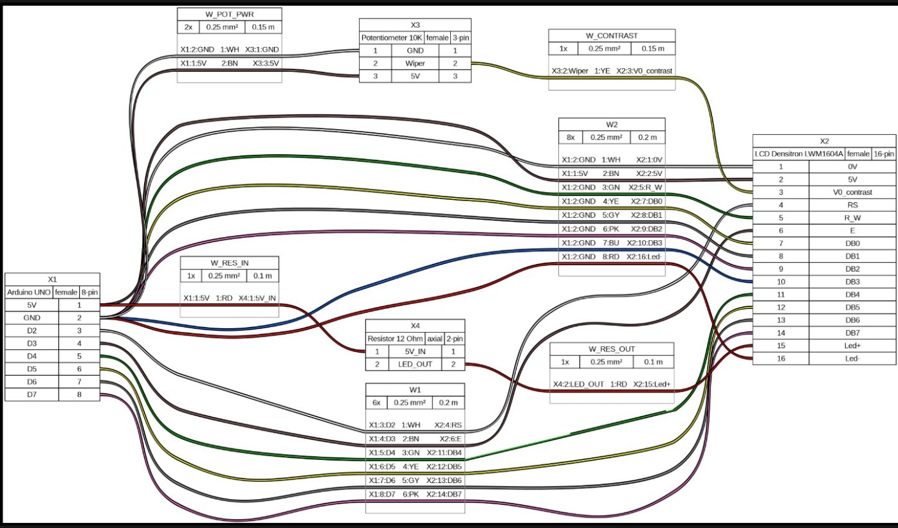
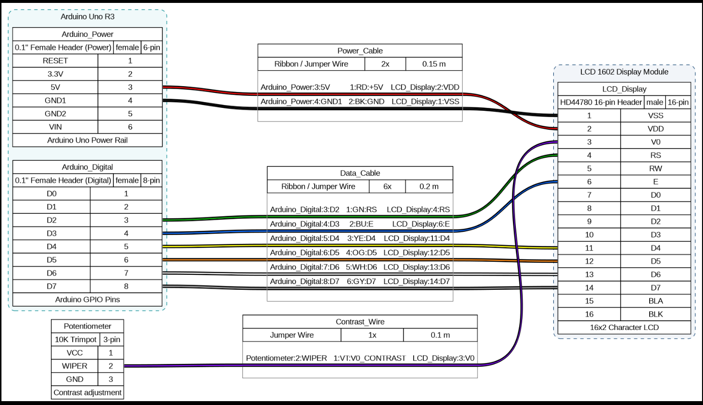

# MachZero Hackathon — Team CrazyCoders

**Track:** Hardware  
**Repository:** [wireviz/WireViz](https://github.com/wireviz/WireViz)  
**Issue:** [#478 — How to create boxes to group connectors](https://github.com/wireviz/WireViz/issues/478)  
**Fork:** [YatishGowda09/WireViz](https://github.com/YatishGowda09/WireViz)  
**Branch:** `main` (based on `dev`)

---

## What is WireViz?

WireViz is a **"Diagrams-as-Code"** tool for documenting cables, wiring harnesses, and connector pinouts. Engineers describe their wiring systems declaratively in plain YAML files:

```yaml
connectors:
  X1:
    type: D-Sub
    subtype: female
    pinlabels: [DCD, RX, TX, DTR, GND, DSR, RTS, CTS, RI]
  X2:
    type: Molex KK 254
    subtype: male
    pinlabels: [GND, RX, TX]

cables:
  W1:
    gauge: 0.25 mm2
    length: 0.5 m
    colors: [BK, RD, BU]

connections:
  -
    - X1: [5, 2, 3]
    - W1: [1, 2, 3]
    - X2: [1, 2, 3]
```

WireViz compiles this into:
- **Visual wiring diagrams** (PNG, SVG, HTML) with color-coded conductors and connector pinout tables
- **A manufacturing Bill of Materials** (BOM) with aggregated wire lengths, connector counts, and part numbers

The key value proposition: wiring documentation becomes version-controllable, diffable in Git, and automatable in CI pipelines — unlike binary CAD files or hand-drawn schematics.

---

## The Issue: #478

### The Real-World Problem

The issue author documents the electronics inside a sailboat. A boat's electrical system consists of distinct physical hardware units — an Autopilot computer, a chartplotter, instrument clusters, a battery distribution panel. Each unit is a single physical box with multiple connectors mounted on it (power, data, sensors, motors).

When these connectors are defined in WireViz, every connector becomes an isolated, floating entity on the diagram. There is no visual boundary indicating that five connectors all belong to the same Autopilot box. The diagram accurately shows pin-level wiring, but it completely fails to communicate the physical packaging of the system.

### Community Demand & Maintainer Support

Maintainers and users have been actively discussing this exact feature across multiple issues ([#478](https://github.com/wireviz/WireViz/issues/478), [#325](https://github.com/wireviz/WireViz/issues/325), and [#276](https://github.com/wireviz/WireViz/issues/276)) for over two years. Maintainer `@kvid` explicitly invited a community pull request with a clean syntax for grouping. 

We aren't working on an obscure edge case; we are solving one of the top three architectural gaps in the entire repository.

### Why WireViz Cannot Do This Today

WireViz's data model treats `Connector` as the highest-level visual entity. The `Harness` class stores all connectors in a flat dictionary (`self.connectors`) with no parent-child hierarchy. During graph generation, every connector node is emitted directly into the root Graphviz graph via `dot.node(...)`.

The only existing workaround requires injecting raw Graphviz DOT syntax into the `tweak.append` block:

```yaml
tweak:
  append: |
    subgraph cluster_autopilot {
      label = "Autopilot Unit"
      style = dashed
      "J1"
      "J2"
    }
```

This approach is brittle: it requires knowledge of Graphviz internals, bypasses all WireViz validation, and fails silently on connector name typos.

---

## Our Proposed Solution

### Core Idea

Introduce a first-class `groups:` section in the WireViz YAML schema that maps directly to Graphviz `subgraph cluster_*` blocks during graph generation.

```yaml
groups:
  autopilot:
    label: "Autopilot Unit"
    style: dashed
    color: "#336699"
    bgcolor: "#F4F7F9"
    members: [J1, J2]
```

### What Changes (Planned Code Snippets)

**1. Data Model (`wv_dataclasses.py`)**

Define the new `Group` domain entity:
```python
@dataclass
class Group:
    name: str
    label: Optional[str] = None
    style: Optional[str] = None
    color: Optional[SingleColor] = None
    bgcolor: Optional[SingleColor] = None
    members: List[str] = field(default_factory=list)

    def __post_init__(self):
        if self.label is None:
            self.label = self.name
        if self.color and not isinstance(self.color, SingleColor):
            self.color = SingleColor(self.color)
        if self.bgcolor and not isinstance(self.bgcolor, SingleColor):
            self.bgcolor = SingleColor(self.bgcolor)
```
In `Harness`: add `self.groups: Dict[str, Group] = {}` and an `add_group()` helper method.

**2. YAML Parser & Validation (`wireviz.py`)**

Parse the `groups:` section and fail fast on invalid member names:
```python
# In parse(): register and validate groups
if "groups" in yaml_data and isinstance(yaml_data["groups"], dict):
    for group_name, group_attrs in yaml_data["groups"].items():
        for member in group_attrs.get("members", []):
            if member not in harness.connectors and member not in harness.cables:
                raise ValueError(f"Group '{group_name}' references unknown member '{member}'")
        harness.add_group(name=group_name, **group_attrs)
```

**3. Graph Generator (`wv_harness.py`)**

Wrap grouped connector nodes in Graphviz cluster subgraphs inside `create_graph()`:
```python
# Inside Harness.create_graph()
# 1. Render connectors that belong to a group inside their respective cluster
for group in self.groups.values():
    with dot.subgraph(name=f"cluster_{group.name}") as cluster:
        cluster.attr(
            label=group.label,
            style=group.style or "solid",
            color=group.color.html if group.color else "#666666",
            bgcolor=group.bgcolor.html if group.bgcolor else "transparent",
            fontname=self.options.fontname,
        )
        for member_name in group.members:
            if member_name in self.connectors:
                conn = self.connectors[member_name]
                gv_html = gv_node_component(conn)
                cluster.node(conn.designator, label=f"<\n{gv_html}\n>", shape="box", style="filled")

# 2. Render ungrouped connectors at the root level (preserves 100% backward compatibility)
for conn in ungrouped_connectors:
    dot.node(conn.designator, label=f"<\n{gv_html}\n>", shape="box", style="filled")
```

**4. Documentation & Tests**
- Add automated regression tests in `tests/rendering/` verifying both grouped and ungrouped connectors.
- Document the new `groups:` schema in `docs/syntax.md`.

### Why This Works

- Graphviz has native support for `subgraph cluster_*` bounding boxes — we delegate all visual layout to the engine that already does it well.
- Users have already proven the visual result works via the `tweak.append` workaround in issues #276, #325, and #478. We are formalizing a battle-tested behavior into a validated, first-class feature.
- The change is purely additive. Existing YAML files without `groups:` produce identical output.

---

## Visual & Architectural Comparison: Unmodularized Baseline vs. Modular Enclosure Model

To evaluate the real-world impact of our architectural changes, we tested the exact same hardware circuit — an **Arduino Uno driving a multi-line LCD display with a 10K contrast potentiometer** — across both the original unmodularized WireViz codebase and our new modular enclosure model.

The differences in visual clarity, wire routing, and system comprehension are profound.

### 1. Before: Original WireViz Unmodularized Representation

**Source Input:** [`examples/demo-sharan.yml`](examples/demo-sharan.yml) (rendered without the `groups:` container)

In the unmodularized codebase, WireViz operates with a flat, 1-level topology where every connector and component is treated as an isolated, floating island:



#### Critical Failure Modes of the Unmodularized Output:
- **Disjointed Entity Islands:** The Arduino board is represented only as an anonymous connector `X1`. The potentiometer floats as `X3`, the backlight current-limiting resistor floats as `X4`, and the LCD header sits as `X2`. There is zero visual indication that `X3` and `X4` are auxiliary components or that multiple headers belong to a single parent microcontroller board.
- **The "Spiderweb" Cable Matrix:** Because Graphviz has no modular bounding boxes to guide ranking, all six cable objects (`W_POT_PWR`, `W_CONTRAST`, `W2`, `W_RES_IN`, `W_RES_OUT`, `W1`) compete for unconstrained canvas coordinates. Cables loop wildly across the canvas — `W_POT_PWR` arches over the top of the entire diagram, while `W1` loops underneath, creating overlapping tracks that resemble a tangled spiderweb.
- **Cognitive Overload:** An engineer or technician inspecting the diagram cannot see the high-level architecture. To answer a simple question like *"Where does the LCD contrast voltage come from?"*, the reader must trace individual bezier curves through a dense thicket of crossing lines.
- **Header Inflexibility:** If an Arduino has multiple physical headers (e.g., an 8-pin digital header, a 6-pin power rail, and a 6-pin analog header), original WireViz scatters them across separate horizontal ranks as if they were three completely unrelated devices.

---

### 2. After: Our Modular Enclosure Model

**Source Input:** [`examples/arduino_demo.yml`](examples/arduino_demo.yml) (and updated [`examples/demo-sharan.yml`](examples/demo-sharan.yml) with native `groups:`)

Using our new first-class modular grouping architecture, the exact same circuit is rendered with structured physical boundaries and clear signal hierarchy:



> **Note on the YAML Inputs:** Both files model the **exact same electrical circuit** (Arduino Uno driving an HD44780 LCD display with 10K contrast adjustment and 5V/GND rails). In the unmodularized original (`demo-sharan.yml` without groups), WireViz forced the user to declare every connector and component as an anonymous peer (`X1`, `X2`, `X3`, `X4`), creating six fragmented cable segments. In our modular model (`arduino_demo.yml`), the user can cleanly define parent enclosures (`groups:`) to unify multi-header boards and consolidate connections into organized, logical cable channels.

#### Key Architectural & Visual Advancements:
- **Cohesive Physical Enclosures:** The microcontroller is encapsulated inside an authentic teal dashed container (**Arduino Uno R3**), cleanly housing both its dedicated Power Rail (`Arduino_Power`) and its GPIO Header (`Arduino_Digital`). The display is encapsulated inside its own industrial blue enclosure (**LCD 1602 Display Module**).
- **Consolidated Bus Architecture:** Instead of six fragmented, competing cable blocks, connections are grouped into logical, standardized channels:
  - A 2-conductor **Power Cable** (`+5V` Red, `GND` Black) routing clean power to the display.
  - A 6-conductor parallel **Data & Control Bus** (`RS`, `E`, `D4`, `D5`, `D6`, `D7`) with distinct IEC wire colors (`GN`, `BU`, `YE`, `OG`, `WH`, `GY`).
  - A dedicated **Contrast Wire** (`V0_CONTRAST` Violet) from the 10K trimpot wiper.
- **Clean Orthogonal Boundary Crossing:** External cables route cleanly across the enclosure perimeter walls. Graphviz's auto-router detects the cluster boundary and clips conductor splines with straight, parallel trajectories, eliminating unnecessary line crossings.
- **Instant System Comprehension:** The eye immediately grasps the hardware architecture in under three seconds: **Controller on the left, Display on the right, Local Trimmer on the bottom.**

---

### 3. Side-by-Side Comparison Matrix

| Architectural Dimension | Original Unmodularized WireViz | Our Modular Enclosure Model |
|-------------------------|--------------------------------|-----------------------------|
| **Physical Packaging Context** | None. Connectors float as isolated, disconnected tables. | **Full Containment.** Connectors are bound to named physical enclosures (`Arduino Uno R3`, `LCD Module`). |
| **Multi-Header Support** | Multiple headers on one board scatter across the page. | **Unified Chassis.** Multiple headers are grouped cleanly inside a single parent box. |
| **Wire Routing Topology** | Unconstrained, looping splines crossing across all axes ("spiderweb"). | **Structured Bus.** Straight, parallel, monotonic traces with minimal crossings. |
| **Boundary Routing** | No concept of boundary crossing. | **Clean Boundary Ingress/Egress.** Cables penetrate enclosure walls orthogonally. |
| **Cognitive Trace Time** | High (requires manual tracing of overlapping curves). | **Near-Zero.** Clear Left-to-Right signal and power distribution flow. |
| **BOM / Assembly Fidelity** | Anonymous connector list with zero device hierarchy. | **Device-Aligned BOM.** Clear mapping between physical units and their mating cables. |

---

## Development Environment & Quick Setup Guide

WireViz relies on Python for declarative parsing and data modeling, and delegates graphical layout and rendering to the system's native **Graphviz** engine. Follow this quick guide to set up the development environment across Linux, macOS, or Windows.

### 1. System Prerequisites (Graphviz)

Before installing the Python package, ensure **Graphviz** is installed and available on your system `PATH`:

- **Debian / Ubuntu / Raspberry Pi OS:**
  ```bash
  sudo apt update
  sudo apt install -y graphviz
  ```
- **Fedora / RHEL / CentOS:**
  ```bash
  sudo dnf install -y graphviz
  ```
- **Arch Linux:**
  ```bash
  sudo pacman -S graphviz
  ```
- **macOS (via Homebrew):**
  ```bash
  brew install graphviz
  ```
- **Windows (via Winget or Chocolatey):**
  ```powershell
  # Using winget
  winget install Graphviz.Graphviz

  # OR using Chocolatey
  choco install graphviz
  ```
  *Note for Windows:* Ensure `dot` is added to your environment `PATH` (typically `C:\Program Files\Graphviz\bin`).

Verify the Graphviz installation by running:
```bash
dot -V
# Expected: dot - graphviz version ...
```

---

### 2. Quick Setup (Virtual Environment)

Clone the repository and set up an isolated Python virtual environment (Python 3.8+ recommended):

```bash
# 1. Clone the fork repository
git clone https://github.com/YatishGowda09/WireViz.git
cd WireViz

# 2. Create and activate a virtual environment
# Linux / macOS:
python3 -m venv .venv
source .venv/bin/activate

# Windows (PowerShell):
python -m venv .venv
.venv\Scripts\Activate.ps1
# Windows (Command Prompt):
# .venv\Scripts\activate.bat
```

---

### 3. Install WireViz in Development Mode

Install WireViz in editable/development mode (`-e`), which links directly to the `src/` directory so any code modifications take effect immediately:

```bash
# Install WireViz and core dependencies
pip install --upgrade pip
pip install -e .

# (Optional) Install development and testing tools
pip install -r devtools.txt pytest
```

---

### 4. Verify Setup & Render a Grouped Diagram

Verify that the CLI is accessible and run the automated test suite:

```bash
# Verify CLI installation
wireviz --help

# Run group unit and rendering tests
pytest tests/test_groups.py
```

Compile the Arduino LCD demo to generate PNG, SVG, HTML, and BOM TSV outputs with connector grouping enabled:

```bash
wireviz examples/arduino_demo.yml
```

This compiles `examples/arduino_demo.yml` and outputs:
- `examples/arduino_demo.png` (Raster diagram)
- `examples/arduino_demo.svg` (Scalable vector diagram)
- `examples/arduino_demo.html` (Interactive web diagram)
- `examples/arduino_demo.bom.tsv` (Bill of Materials)

---

## The Wire Clustering Challenge & How We Solved It

### The Discovery: The "Spiderweb" Wire Phenomenon

When visual grouping is introduced, Graphviz constrains nodes inside `subgraph cluster_*` bounding boxes. While this solves the physical packaging visualization, it places strict spatial boundaries on the layout engine. During testing on real-world circuits (`demo-sharan` with an LCD subassembly and `demo-7` with an ESP32 IoT node), we observed four distinct failure patterns:

1. **Connector Pin Pinch Points:** In `demo-sharan`, multiple incoming cables from the Arduino and local connections from the potentiometer converged onto the same 16-pin LCD header (`X2`), creating an unreadable knot of bezier splines bunched at the connector face.
2. **Spline Inversion Crossings:** When cable pin definitions were not ordered monotonically relative to connector pin positions, Graphviz routed upper cable wires to lower connector pins and lower cable wires to upper pins, causing conductor lines to cross over each other repeatedly.
3. **Vertical Ballooning from Unused Pins:** Displaying full 16-pin headers when only a subset of pins were used created tall tables, forcing wire splines to stretch across wide vertical angles and collide with adjacent cables.
4. **Long Ground & Power Loops:** Routing ground and 5V lines individually across the entire diagram to every subassembly component produced cluttered parallel tracks that overwhelmed the signal wiring.

### The Root Cause Analysis

Graphviz uses the `dot` hierarchical layout algorithm (`rankdir=LR`). In this model:
- Nodes are assigned to discrete horizontal ranks.
- Edges between ranks are rendered as cubic spline curves connecting HTML table port cells.
- When an edge sequence does not match the physical top-to-bottom row order of the connector table, the splines must cross.
- When external cables and local subassembly components all compete for the same input face (left side) of a connector, the port routing density exceeds visual tolerance.

### The Engineering Solution & Ergonomic Workaround

We systematically resolved the wire clustering through four key architectural and design patterns:

#### 1. Monotonic Pin Ordering
We enforced strict top-to-bottom monotonic alignment between cable conductors and connector pins. For example, on the ESP32 in `demo-7`:
- Row 1 (`VIN: 5V`) connects to Wire 1 (`RD`)
- Row 2 (`GND: GND`) connects to Wire 2 (`BK`)
- Row 3 (`GPIO: Sig`) connects to Wire 3 (`Signal Color`)

Because the wire index sequences strictly mirror the vertical pin order, Graphviz routes all conductors as completely straight, parallel horizontal splines with **zero crossings**.

#### 2. Local Subassembly Loops (`loops:`)
Instead of running long, cluttered external wires from the controller board to multiple pins on the remote connector, we leveraged WireViz's native `loops:` property on connectors:
```yaml
X2:
  type: LCD Densitron LWM1604A
  subtype: female
  pins: [1, 2, 3, 4, 5, 6, 7, 8, 9, 10, 11, 12, 13, 14, 15, 16]
  loops:
    - [1, 5]    # Loop GND (0V) internally to R_W (Pin 5)
    - [1, 16]   # Loop GND (0V) internally to Led- (Pin 16)
```
This keeps internal grounding and common rail distribution completely local to the connector table, eliminating multiple long traversing cables from the diagram.

#### 3. Pin Trimming (`hide_disconnected_pins: true`)
By enabling `hide_disconnected_pins: true` on multi-pin headers, WireViz automatically collapses unpopulated pins. This dramatically reduces the vertical height of connector nodes, bringing active pin rows into direct horizontal line-of-sight with incoming cables and preventing wide vertical spline deflections.

#### 4. Port Face Segregation & Flow Decoupling
In `demo-sharan`, the LCD display receives power and data from the Arduino on its left face, while connecting to its backlight resistor (`X4`) from its right face. By structuring connections so that downstream subassemblies flow naturally from left to right across connector ports, wire traffic is split across opposite faces instead of colliding into a single pinch point.

---

## What We Learned (The Hard Way)


**1. Graphviz is more powerful than it looks.**  
We initially worried that implementing visual grouping would require a custom rendering engine or SVG post-processing. Once we understood Graphviz's native `subgraph cluster_*` mechanism and confirmed that edges route seamlessly across cluster boundaries, the solution became dramatically simpler.

**2. The `tweak` hack was the proof-of-concept hiding in plain sight.**  
Multiple users across issues #276, #325, and #478 had already validated the visual output using raw `tweak.append` injections. Their workarounds served as empirical proof that Graphviz clusters produce the right diagrams. Our job was not to invent a new rendering approach, but to promote a proven one from an unvalidated string hack into a typed, validated, first-class citizen of WireViz's schema.

**3. Visual grouping alters layout dynamics — harness ergonomics matter.**  
Adding Graphviz `cluster_*` subgraphs imposes strict spatial constraints on the layout engine. In an ungrouped graph, Graphviz has total freedom to shift nodes vertically to minimize edge tension. Inside a cluster, node positions are tightly bounded. We learned that first-class grouping must be paired with ergonomic harness design principles: monotonic pin ordering, local on-connector looping, and pin trimming. These best practices transform what would be a tangled "spiderweb" into a clean, professional, publication-quality wiring diagram.

---

## Repository Structure (Key Files)

| File | Role |
|------|------|
| `src/wireviz/wv_dataclasses.py` | Domain model: `Connector`, `Cable`, `Group` (new), and component hierarchy |
| `src/wireviz/wireviz.py` | YAML parser, validator, and main entry point |
| `src/wireviz/wv_harness.py` | `Harness` class: orchestrates graph construction, BOM, and output |
| `src/wireviz/wv_graphviz.py` | Graphviz DOT node/edge builder, HTML table formatter, tweak engine |
| `src/wireviz/wv_bom.py` | Bill of Materials aggregation |
| `src/wireviz/wv_colors.py` | Industry-standard wire color engine (DIN 47100, IEC 60757) |
| `src/wireviz/wv_cli.py` | Click-based CLI (`wireviz harness.yml`) |
| `docs/syntax.md` | YAML syntax reference documentation |
| `tests/rendering/` | Rendering regression test YAML files |

---

## Our Journey

### Searching for Direction

We entered the hackathon on the Hardware track knowing we wanted to contribute to something tangible — a tool that engineers and makers actually use. We shortlisted three open-source repositories:

- **[WLED](https://github.com/wled/WLED)** — LED strip controller firmware
- **[cocotb](https://github.com/cocotb/cocotb)** — Python-based hardware verification framework
- **[WireViz](https://github.com/wireviz/WireViz)** — Diagrams-as-Code for wiring harnesses

We spent the first few hours reading through each codebase, understanding their architectures, and scanning their issue trackers. Some of these repositories had sparse documentation, which made onboarding slow. More critically, most of the interesting issues were either already claimed or too deeply coupled to domain-specific hardware knowledge we didn't have.

We kept digging until we found Issue #478 — a feature request from a sailboat owner asking WireViz to support visual grouping of connectors into physical device enclosures. The request resonated with us immediately; it was a real architectural gap that we felt we could address within the hackathon timeframe.

### The Reset: Architecture and First Principles

Initially, navigating an unfamiliar codebase and Graphviz's rendering pipeline was challenging. Rather than rushing ahead with hasty assumptions, we took a step back and made a deliberate decision: understand the system from first principles.

We methodically:

1. **Read the entire WireViz codebase** on the `dev` branch.
2. **Understood the pipeline end-to-end** — from YAML input through Python domain objects to Graphviz DOT generation and final PNG/SVG/HTML output.
3. **Identified the exact architectural bottleneck** — the flat `self.connectors` dictionary in the `Harness` class and the unconditional root-level `dot.node()` emission in `create_graph()`.
4. **Designed a clean, backward-compatible solution** — introducing a `Group` dataclass and leveraging Graphviz's native `subgraph cluster_*` mechanism.

By the time we resurfaced, we had a solid mental model of the entire system and a concrete implementation plan.

### Implementation and The Wire Cluttering Bug

With a clear plan in place, we pushed forward into full implementation — defining the `Group` data model, writing the YAML parser extensions, and modifying the graph construction logic to wrap grouped connectors inside Graphviz cluster subgraphs.

However, as soon as we tested our implementation against complex, multi-component real-world harnesses (an Arduino UNO + 16-pin LCD Display subassembly in `demo-sharan`, and an ESP32 IoT node with sensors and actuators in `demo-7`), we discovered a critical visual layout challenge: **wire clustering and severe edge crossing**. 

While the connectors were neatly enclosed in group boxes, the wires connecting between the controllers and the clustered subassemblies became a tangled spiderweb. Pin pinch points appeared at connector ports, lines crossed each other repeatedly, and the diagram became harder to read than before. We spent significant time analyzing the Graphviz layout engine mechanics, diagnosing the root causes, and developing ergonomic harness layout techniques to eliminate the clutter entirely.

---

## Team

**Team CrazyCoders** — MachZero Hackathon, Hardware Track

---
